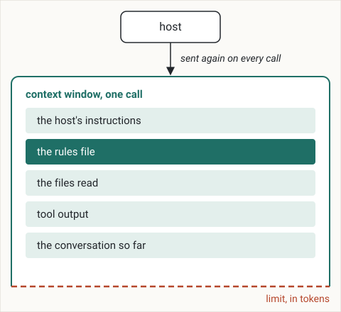

# 1. How an agent sees your project

The model behind a coding agent remembers nothing from one call to the next.
After this chapter you can explain why a coding agent knows only what is in its context window at each call, why a long session gets worse, why its answer sounds just as sure when a fact was not in the window, what to keep in writing so that a fresh session starts right, and what to have the agent read again after a compaction or when you resume a session.

## The model remembers nothing between calls

A coding agent is two programs.
The model reads text and writes text.
The host, the program you run (Claude Code, Codex, Cursor and others), reads your files, runs commands, talks to the model and shows you the result.
Each time the host needs the model, it makes a call: it sends text and receives an answer.

The model keeps nothing from one call to the next.
Anthropic's documentation says so directly: "*The Messages API is stateless, which means that you always send the full conversational history to the API.*"[^messages-api]
The conversation you see on the screen is kept by the host, which sends all of it again with every call.
A fresh session starts with an empty conversation, and the model knows nothing of the previous one, however long it was.

## The context window

Everything the model sees in one call is its context window.
In a coding agent it holds:

* the host's instructions: which tools exist, how to use them, how to answer;
* the rules file, `AGENTS.md` or the host's equivalent, which the host loads when a session starts;
* the files the agent has read in this session;
* the output of the tools it ran: commands, searches, test results;
* the conversation so far: your messages and its answers.



The window is measured in tokens.
A token is the unit of text a model reads and counts: a common word is one token, a long or rare word is a few.
Each model has a limit on how many tokens one call can hold.
Every file the agent reads and every output it receives takes space in the window and stays there until the session ends or a compaction summarizes it.

## More context, less accuracy

A long session puts more in the window, and the model uses what is there less well.
This loss of accuracy as the context grows is called context rot.

Nelson Liu and colleagues, in the paper "Lost in the Middle", published in 2024 in the Transactions of the Association for Computational Linguistics, gave models a question and many documents, only one of which held the answer, and moved that document through the input.
Accuracy "*is often highest when relevant information occurs at the beginning or end of the input context, and significantly degrades when models must access relevant information in the middle of long contexts, even for explicitly long-context models.*"[^liu-2024]

Chroma, the company behind an open-source search database for AI applications, measured 18 models as the input grew, in a 2025 report, and found that "*model performance varies significantly as input length changes, even on simple tasks*", and that "*their performance grows increasingly unreliable as input length grows.*"[^chroma-2025]

Anthropic describes the same effect in every model: "*as the number of tokens in the context window increases, the model's ability to accurately recall information from that context decreases.*"[^anthropic-context-2025]
It calls context "*a finite resource with diminishing marginal returns.*"[^anthropic-context-2025]

In a session, this means the instruction you gave at the start ends up in the middle, under every file read and every command output that came after it.

## When the window fills

A session that goes on long enough reaches the limit.
The host can then compact it, which Anthropic describes as "*taking a conversation nearing the context window limit, summarizing its contents, and reinitiating a new context window with the summary.*"[^anthropic-context-2025]

Compaction lets the session continue, and it costs detail.
A summary is shorter than what it summarizes, and it keeps what looked important when it was written.
Anthropic warns that compacting too aggressively "*can result in the loss of subtle but critical context whose importance only becomes apparent later.*"[^anthropic-context-2025]
A decision you made in the conversation, and that the agent followed until then, can be the detail the summary drops.

## What is not in the window

The model writes the most likely next text, from what is in its window and from what it learned in training.
It writes it whether or not the fact it needs was in the window.
So an agent says what it does not know with the same assurance as what it knows: in my work with agents, I have rarely seen one say "I don't know".
When the fact is not in the window, the agent answers in one of three ways:

* it states a guess as a fact;
* it answers from what the model learned in training, which may have nothing to do with your project: an API of another version, a convention of another codebase;
* rarely, and often in passing, it says it is not sure and proposes a way to gather evidence for its hypothesis.

Adam Tauman Kalai and colleagues, in a 2025 paper, argue that training and evaluation "*reward guessing over acknowledging uncertainty.*"[^kalai-2025]
Most tests score a model the way an exam scores a student: a point for a right answer and none for a blank or an "I don't know".[^kalai-2025]
So "*guessing when uncertain improves test performance.*"[^kalai-2025]

A hypothesis is not always true, and nothing in the tone of the answer tells it from a fact.
Your judgment does: check the claim against the project's files, or ask the agent to test it and show you the result.

## What this changes in your project

Two practices follow.

**Decisions go in files the agent reads at the start of every session.**
A decision that lives only in the conversation is gone in a fresh session and can be lost in a compaction.
A decision in a file can be read again, in any session and at any point of one.
The rules file is the entry point: the host loads it at the start of every session, it is short, and it names the documents to read before acting.
This is the start of a rules file for a small lending library, the project whose code Part I uses as its example, written for this chapter:

```markdown
# Lending library

A small library lends copies of its books to members; a librarian records
each loan and each return.

## Read before acting
- the product: docs/00 · the vocabulary: docs/03
- how it is built: docs/01 · style and tests: docs/04
- process: docs/05 · queue: docs/06
```

A fresh session reads what the project is in one line, then where each kind of fact lives; the files it names hold the rest.

A file does not stay whole in the window: a document the agent read at the start of a session ends up, as the session grows, in the middle, where the model uses it worst, and a compaction summarizes it like the rest of the conversation.
Anthropic recommends the same practice for agents: notes "*persisted to memory outside of the context window*" that "*get pulled back into the context window at later times.*"[^anthropic-context-2025]
So after a compaction, when you resume a session, or when the work drifts from a decision you made, ask the agent to reopen the delivery's page and the documents the work depends on before it goes on; the summary does not say what it dropped.
A decision that was never written in a file has nothing to reopen.

**Each delivery gets a fresh session.**
In a fresh session the window holds the rules file, the documents and the page of the delivery, and nothing left over from the previous one.
Deciding and building go in separate sessions too.
The conversation that weighed the options, including the ones you rejected, stays out of the window where the code is written; what reaches it is the decision, written on one page.
In focus-kit, `/propose` writes that page and `/apply` builds it in a fresh session.

## What the team gains

Decisions survive the session: what the team decided is in files, so when a summary drops a decision, or a long session drifts from it, you have the agent read it again from the page and the documents instead of trusting what it remembers.
The work survives too: in focus-kit every delivery has a page, committed with the code it describes, that records why it was made, what "done" meant and, once built, what was done and how.
So a person new to the project, a developer or a manager, reads the same files the agent reads, asks the agent about the project and gets an answer read from those pages, not from a colleague's memory.
The evidence is the loss the studies above measured; reading the written record again is the practice Anthropic recommends against it.

## Key points

* The model remembers nothing between calls: the host sends the whole conversation every time, and a fresh session starts empty.
* The context window is everything the model sees in one call: the host's instructions, the rules file, the files read, tool output and the conversation so far, measured in tokens, up to a limit.
* More context means less accuracy: information in the middle of a long input is used worst, reliability falls as the input grows, and compaction replaces the conversation with a summary that can drop a detail that mattered.
* An agent answers what is not in its window with the same assurance as what is, from training or from a guess, so a confident answer is a hypothesis until you check it.
* Keep decisions in files, and after a compaction or when you resume a session, have the agent reopen the page and the documents: a file is a record to read again, not text the window is sure to keep.
* Give each delivery a fresh session, with deciding apart from building.
* Commit each delivery's page with its code, and ask the agent, not a colleague, what the project did and why.

[^messages-api]: Anthropic, "Using the Messages API", accessed 2026-09-25. <https://platform.claude.com/docs/en/build-with-claude/working-with-messages>
[^liu-2024]: Liu et al., "Lost in the Middle: How Language Models Use Long Contexts", 2024. <https://arxiv.org/abs/2307.03172>
[^chroma-2025]: Chroma, "Context Rot: How Increasing Input Tokens Impacts LLM Performance", 2025. <https://research.trychroma.com/context-rot>
[^anthropic-context-2025]: Anthropic, "Effective context engineering for AI agents", 2025. <https://www.anthropic.com/engineering/effective-context-engineering-for-ai-agents>
[^kalai-2025]: Adam Tauman Kalai, Ofir Nachum, Santosh S. Vempala and Edwin Zhang, "Why Language Models Hallucinate", 2025. <https://arxiv.org/abs/2509.04664>
